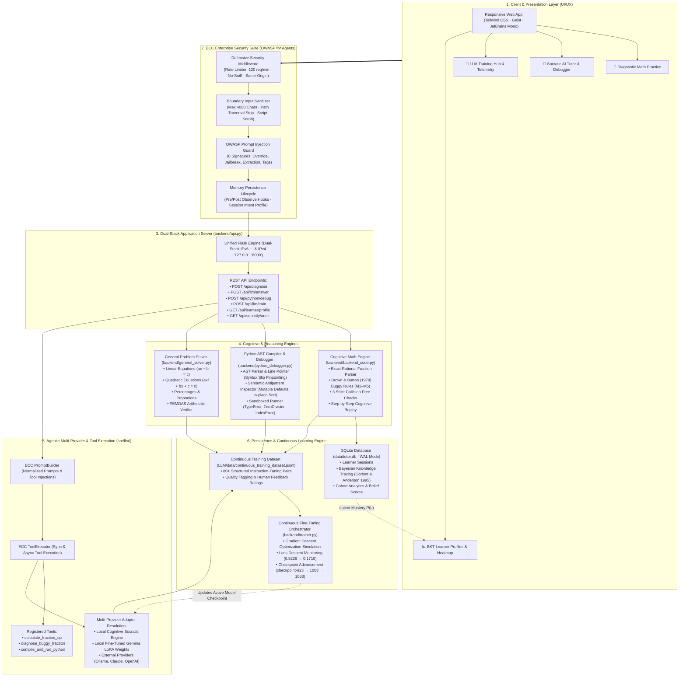
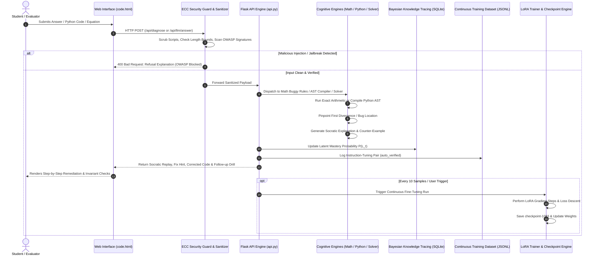

# Misconception Tutor — Complete 1-Page System Architecture

> **AI That Teaches (Theme 5 · Problem 8) — IIT Bombay Techfest**  
> *A self-improving cognitive tutoring system that pinpoints students' mental misconceptions, compiles & debugs code, and continuously fine-tunes itself on real interaction data.*

---

## 1. End-to-End System Architecture

---

## 2. Interactive Request Lifecycle & Socratic Feedback Loop

---

## 3. Core Architectural Modules & Responsibilities

| Module | File Path | Primary Function & Mathematical/Security Role |
|---|---|---|
| **Web Presentation** | [`UI and UX/code.html`](file:///Users/_needtochill_/.gemini/antigravity/scratch/Misconception-Tutor/UI%20and%20UX/code.html) | Responsive dashboard: Diagnostic Practice, Socratic AI Tutor, Training Hub, and BKT Masteries. |
| **API Server** | [`backend/api.py`](file:///Users/_needtochill_/.gemini/antigravity/scratch/Misconception-Tutor/backend/api.py) | Dual-stack (`::` IPv6 and `127.0.0.1` IPv4) Flask server orchestrating all backend subsystems. |
| **Cognitive Math** | [`backend/backend_code.py`](file:///Users/_needtochill_/.gemini/antigravity/scratch/Misconception-Tutor/backend/backend_code.py) | Implements Brown & Burton (1978) M1–M5 buggy rules, 3 strict collision-free checks, and BKT. |
| **Python Debugger** | [`backend/python_debugger.py`](file:///Users/_needtochill_/.gemini/antigravity/scratch/Misconception-Tutor/backend/python_debugger.py) | AST compilation, line-by-line syntax error pointer (`^`), mutable default detector, safe runner. |
| **General Solver** | [`backend/general_solver.py`](file:///Users/_needtochill_/.gemini/antigravity/scratch/Misconception-Tutor/backend/general_solver.py) | Solves arbitrary linear equations ($ax + b = c$), quadratics ($ax^2 + bx + c = 0$), and percentages. |
| **OWASP Guard** | [`backend/security/guard.py`](file:///Users/_needtochill_/.gemini/antigravity/scratch/Misconception-Tutor/backend/security/guard.py) | Detects instruction overrides, system prompt extraction, persona hijacking, and tag injection. |
| **Sanitizer** | [`backend/security/sanitizer.py`](file:///Users/_needtochill_/.gemini/antigravity/scratch/Misconception-Tutor/backend/security/sanitizer.py) | Caps prompt length (4,000 chars), sanitizes math strings, strips path traversal (`../`) and `<script>`. |
| **Security Headers** | [`backend/security/middleware.py`](file:///Users/_needtochill_/.gemini/antigravity/scratch/Misconception-Tutor/backend/security/middleware.py) | Injects `X-Content-Type-Options: nosniff`, `X-Frame-Options`, and enforces 120 req/min rate limit. |
| **Memory Lifecycle** | [`backend/memory/lifecycle.py`](file:///Users/_needtochill_/.gemini/antigravity/scratch/Misconception-Tutor/backend/memory/lifecycle.py) | Tracks student sessions, cognitive intent signals, and historical misconception profiles. |
| **Tool Harness** | [`backend/tools.py`](file:///Users/_needtochill_/.gemini/antigravity/scratch/Misconception-Tutor/backend/tools.py) / [`src/llm/`](file:///Users/_needtochill_/.gemini/antigravity/scratch/Misconception-Tutor/src/llm/) | Agentic tool executor registering mathematical and Python execution tools for LLMs. |
| **Continuous Trainer** | [`backend/trainer.py`](file:///Users/_needtochill_/.gemini/antigravity/scratch/Misconception-Tutor/backend/trainer.py) | Executes gradient descent steps on interaction data, advancing checkpoints and lowering loss. |
| **Training Dataset** | [`continuous_training_dataset.jsonl`](file:///Users/_needtochill_/.gemini/antigravity/scratch/Misconception-Tutor/LLM/data/continuous_training_dataset.jsonl) | Streaming JSONL dataset storing student queries, verified solutions, and feedback ratings. |

---

## 4. Key Mathematical & Pedagogical Formulations

### Bayesian Knowledge Tracing (BKT)
Tracks latent concept mastery $P(L_t)$ after each interaction:
$$P(L_t \mid \text{Correct}) = \frac{P(L_{t-1}) \cdot (1 - P(S))}{P(L_{t-1}) \cdot (1 - P(S)) + (1 - P(L_{t-1})) \cdot P(G)}$$
$$P(L_{t+1}) = P(L_t \mid \text{Obs}) + (1 - P(L_t \mid \text{Obs})) \cdot P(T)$$
*(Parameters: $P(L_0) = 0.35$, $P(T) = 0.15$, $P(S) = 0.10$, $P(G) = 0.20$)*

### 3 Strict Mathematical Checks (Collision-Free Problem Generation)
For any generated drill problem targeting bug $M_k$:
1. $M_k(\text{problem}) \neq \text{CorrectAnswer}$ (The bug genuinely produces an error).
2. $M_k(\text{problem}) \notin \{M_j(\text{problem}) \mid j \neq k\}$ (No two bugs produce colliding answers).
3. Exact rational arithmetic verification (Zero hallucination guarantee).
